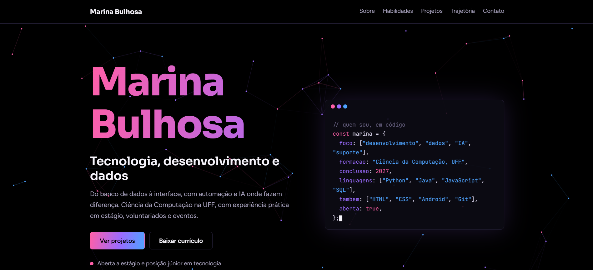

# Portfólio | Marina Bulhosa

Meu portfólio profissional: quem sou, o que sei fazer e os projetos que já construí em desenvolvimento, dados e IA.

**Acesse o site:** https://marinabulhosa.github.io

 

## Sobre mim

Estudo Ciência da Computação na UFF (conclusão prevista para 2027) e tenho experiência prática em estágio, voluntariados técnicos e eventos da universidade. Estou aberta a estágio e posição júnior em tecnologia, desenvolvimento de sistemas e dados.

## O que tem no site

- Apresentação, Sobre mim e soft skills
- Habilidades organizadas por área
- Projetos com filtro por área e um caso para cada um (problema e o que foi construído)
- Trajetória profissional e formação
- Contato com formulário e botão para baixar o currículo

Efeitos visuais: rede de partículas animada, código digitado no topo, contadores, barra de progresso de leitura, linha do tempo animada e brilho nos cards. As animações respeitam a configuração de movimento reduzido do dispositivo.

## Tecnologias

HTML 5, CSS 3 e JavaScript puro, sem frameworks nem bibliotecas. Fontes do Google Fonts (Sora, Figtree e JetBrains Mono). Hospedado no GitHub Pages.

## Estrutura

```
├── index.html
├── css/style.css
├── js/script.js
├── img/foto.jpg
└── docs/curriculo.pdf
```

## Como rodar localmente

1. Baixe ou clone o repositório.
2. Abra o arquivo `index.html` no navegador (dois cliques). Não precisa instalar nada.

## Como personalizar

- **Projetos:** edite a lista `P` no começo do `js/script.js`.
- **Link do GitHub:** altere a constante `GH` no mesmo arquivo.
- **Habilidades:** edite a lista `SK` no mesmo arquivo.
- **Foto e currículo:** substitua `img/foto.jpg` e `docs/curriculo.pdf`.
- **Formulário:** cole a URL do formulário do Formspree em `FORM_ENDPOINT`. Sem ela, o formulário abre o Gmail com a mensagem pronta.

## Contato

- E-mail: marinabulhosa@gmail.com
- LinkedIn: https://www.linkedin.com/in/marinabulhosa
